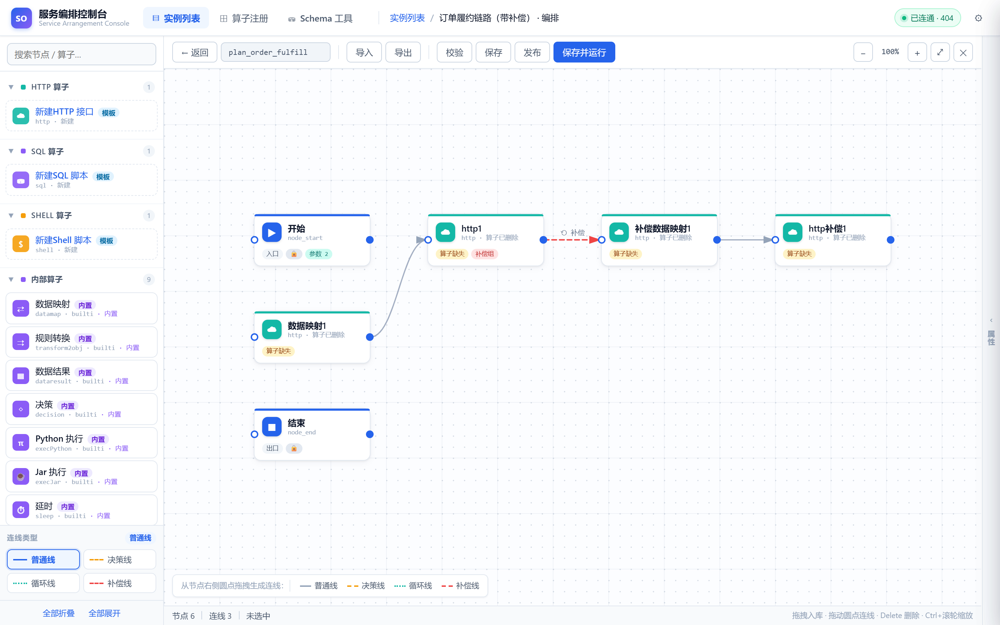
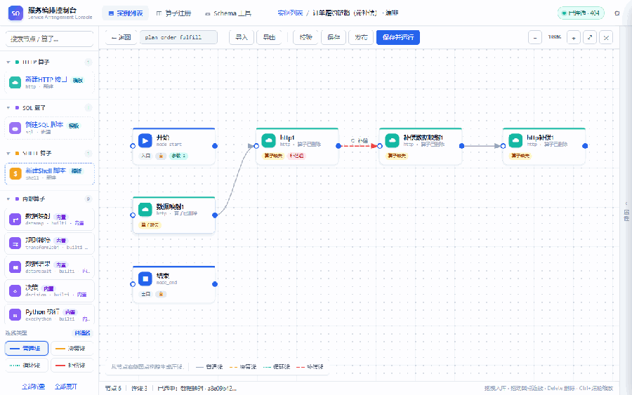
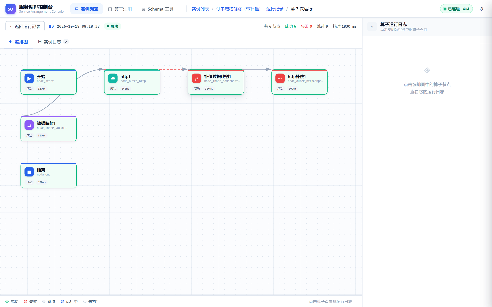
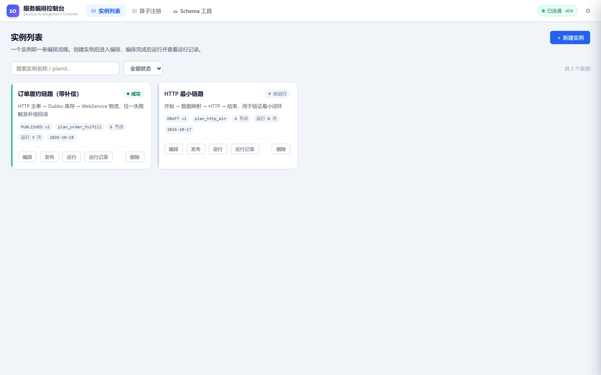
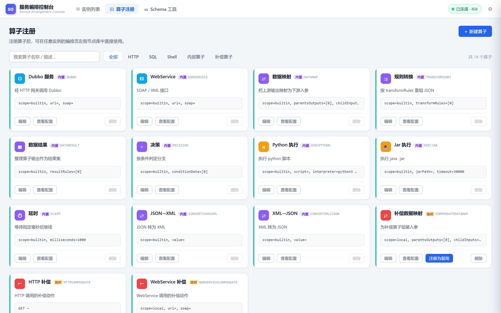
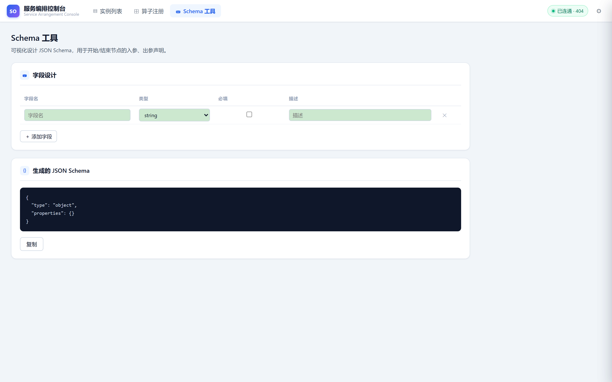
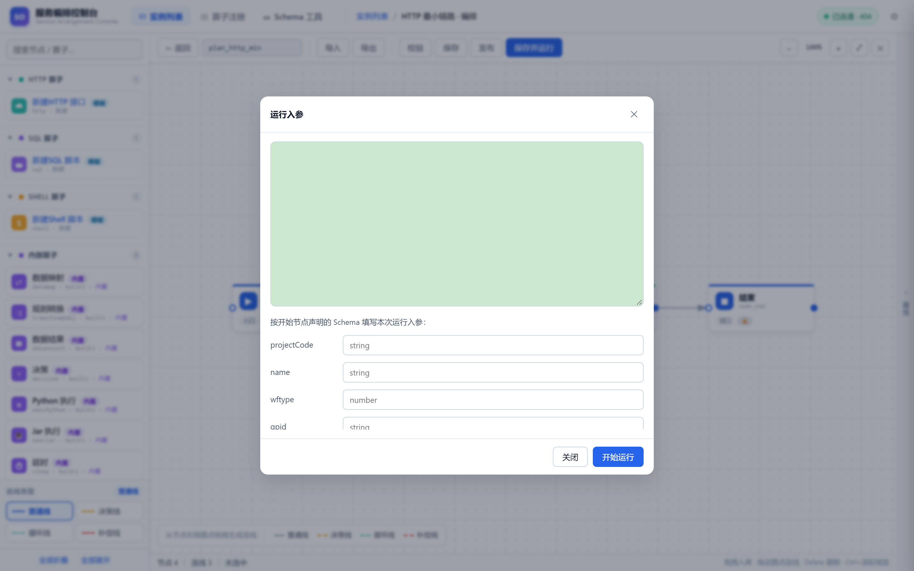
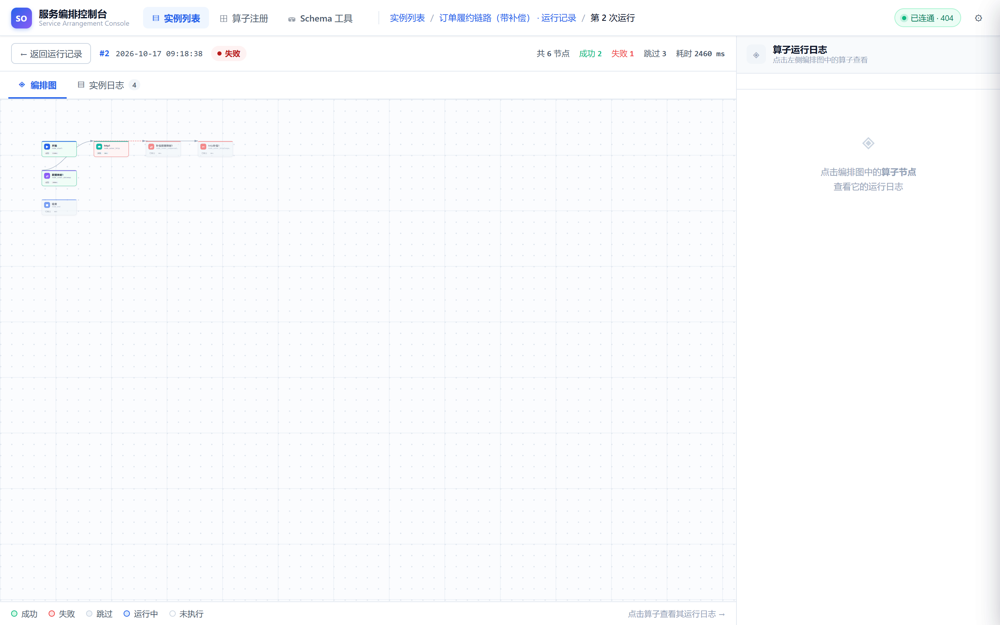

# service-arrange · 服务编排平台

基于 DSL 的服务编排平台。用一份可视化编排的 JSON（DSL）把多个分散的服务串成可执行流程，提供解析、调度执行、状态日志、失败补偿、循环与条件分支能力。

> 详细说明见 [`docs/`](./docs) 目录，建议从 [文档说明](./docs/文档说明.md) 开始。
> English version: [`README.en.md`](./README.en.md)。

---

## 界面预览

**编排设计器**：左侧分类节点库（HTTP / SQL / Shell / 内部算子），画布支持普通线、决策线、循环线、补偿线四种线型，节点可拖拽、属性面板分组编辑。





**运行详情**：每次运行一条记录，编排图按结果染色（成功 / 失败 / 跳过 / 运行中 / 未执行），可下钻到算子级日志。



<details>
<summary>更多截图（实例列表 / 算子注册 / Schema 工具 / 运行入参 / 失败补偿）</summary>







</details>

---

## 仓库结构

```
service-arrange/
├── README.md                   项目入口与快速开始
├── LICENSE
├── pom.xml                     根 POM（聚合 backend）
│
├── backend/                    后端（Maven 多模块）
│   ├── pom.xml                 后端聚合 POM
│   ├── engine/                 核心引擎：DSL 解析、任务调度、算子执行、持久化
│   └── web/                    Web 接入层：REST 接口与启动类
│
├── frontend/                   可视化编排控制台（纯静态，零依赖）
│   ├── index.html
│   ├── css/style.css
│   ├── js/*.js
│   └── serve.js                本地零依赖静态服务器（Node 内置模块）
│
└── docs/                       项目文档
    ├── 文档说明.md              文档体系入口与体例基准
    ├── 01-项目总览.md
    ├── 02-DSL规范.md
    ├── 03-执行引擎与调度流程.md
    ├── 04-数据模型与消息模型.md
    ├── 05-REST接口说明.md
    ├── 06-前端控制台说明.md
    ├── 07-算子扩展指南.md
    ├── 08-架构图与实现状态.md
    ├── 09-功能清单.md
    ├── 10-项目现状.md
    ├── 11-快速开始.md
    ├── 12-配置说明.md
    ├── 13-部署指南.md
    ├── 14-测试指南.md
    ├── 15-系统架构.md
    └── 16-编码规范.md
```

---

## 快速开始

### 前端控制台

无需构建，直接用浏览器打开：

```
frontend/index.html
```

或启动仓库自带的零依赖静态服务器（推荐）：

```powershell
cd frontend
node serve.js      # 默认监听 127.0.0.1:5173
```

其他等价的静态服务器（可选，需要本地已装 Node/npm 或 Python）：

```powershell
npx serve .
python -m http.server 5173
```

打开后在右上角「接口设置」中填入后端地址（**需含上下文路径**，如 `http://localhost:8082/servicearrange`），点「连通性检测」确认。

### 后端

```powershell
cd backend
mvn -pl web -am spring-boot:run
```

> 完整启动步骤（含 MongoDB / RabbitMQ / ZooKeeper 准备）见 [快速开始](./docs/11-快速开始.md)。

### 构建产物

```powershell
cd backend
mvn clean package -DskipTests
```

产物：`backend/web/target/service-arrange.jar`（可执行 Spring Boot jar）。

---

## 核心概念

| 概念 | 说明 |
| --- | --- |
| **DSL** | 一份 JSON，描述流程的画布元素（节点 + 连线）与强组合 |
| **Cell** | 节点或连线的统称，两者同构 |
| **Inst** | 一次流程运行的上下文（解析后的图、全局参数、状态集合、出参）|
| **Task** | 一个节点在某个循环次数下的一次执行记录 |
| **决策线** | 条件线，条件成立才流转 |
| **循环线** | 圈定区间并定义循环退出条件（doWhile / whileDo）|
| **强组合 + 补偿线** | 节点失败后触发补偿分支，实现局部事务回滚 |
| **算子** | 最小执行单元（HTTP / Dubbo / WebService / 脚本 / 内部算子）|

---

## 技术栈

| 层次 | 技术 |
| --- | --- |
| 前端 | 原生 HTML5 / CSS3 / ES5 JavaScript（零依赖、零构建）|
| 后端 | Java 8、Spring Boot 2.1.5、Spring Cloud Stream |
| 消息 | RabbitMQ |
| 存储 | MongoDB |
| 协调 | ZooKeeper + Curator（实例级分布式锁）|
| 表达式 | Spring SpEL + 自定义取值表达式 |
| 工具 | Hutool、Lombok |

---

## 文档导航

| 分类 | 文档 |
| --- | --- |
| **入门** | [文档说明](./docs/文档说明.md) · [快速开始](./docs/11-快速开始.md) · [项目总览](./docs/01-项目总览.md) |
| **产品与现状** | [项目现状](./docs/10-项目现状.md) · [功能清单](./docs/09-功能清单.md) |
| **设计与架构** | [系统架构](./docs/15-系统架构.md) · [DSL规范](./docs/02-DSL规范.md) · [执行引擎与调度流程](./docs/03-执行引擎与调度流程.md) |
| **开发与接口** | [REST接口说明](./docs/05-REST接口说明.md) · [算子扩展指南](./docs/07-算子扩展指南.md) · [前端控制台说明](./docs/06-前端控制台说明.md) · [编码规范](./docs/16-编码规范.md) |
| **数据与运维** | [数据模型与消息模型](./docs/04-数据模型与消息模型.md) · [配置说明](./docs/12-配置说明.md) · [部署指南](./docs/13-部署指南.md) · [测试指南](./docs/14-测试指南.md) · [架构图与实现状态](./docs/08-架构图与实现状态.md) |

---

## License

见 [LICENSE](./LICENSE)。
